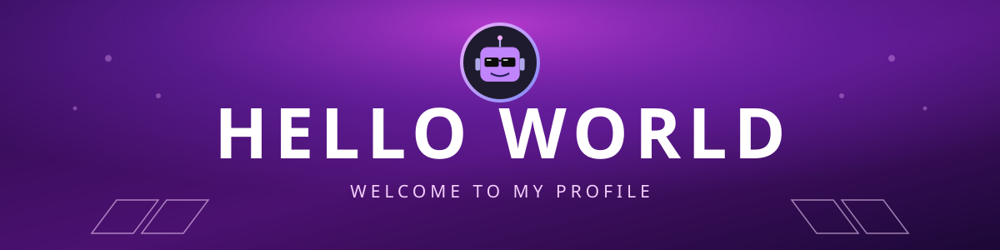

# Hey 👋 I'm Aryan Raj

---

## 👨‍💻 About Me

- 🎓 B.Tech student in **Computer Science and Engineering (Specialization in Artificial Intelligence Machine Learning)**
- 🏫 **Vellore Institute of Technology, Bhopal**
- 🧠 Interested in building intelligent systems with Python, data and machine learning
- 🏆 Hackathon participant who enjoys turning ideas into working prototypes

### 📫 Connect with me

    
    
    
    
  
  

---

## 🛠️ Skills

### 💻 Programming Languages

### 📊 Data Science and Machine Learning

### 📚 Currently Learning

### ☁️ Backend and Deployment

### 🧰 Tools

---

## 🚀 Featured Project

### 🧠 [NeuroNex Maze AI](https://github.com/Aryan-0-07/NeuroNex-Maze-AI)

A maze chase game with an opponent that actually learns. Instead of following fixed rules, the NPC is driven by a **Spiking Neural Network** (LIF neurons with STDP learning) that picks up on how you move. As it watches you play, it grows smarter in three stages: it starts out wandering at random, moves on to chasing you with BFS pathfinding, and finally predicts where you're heading to cut you off.

👉 [View the repository](https://github.com/Aryan-0-07/NeuroNex-Maze-AI)

---

## 🏆 Experience

- 🥇 **NeuroNex Hackathon**: Participant
- 🏥 **Health Hackathon**: Participant

---

## 📊 GitHub Stats

---

## 🐍 Contribution Snake

<picture>
  <source media="(prefers-color-scheme: dark)" srcset="https://raw.githubusercontent.com/Aryan-0-07/Aryan-0-07/output/github-snake-dark.svg" />
  <source media="(prefers-color-scheme: light)" srcset="https://raw.githubusercontent.com/Aryan-0-07/Aryan-0-07/output/github-snake.svg" />
  
</picture>

---

⭐ Thanks for stopping by. Feel free to star a repo or say hi!

